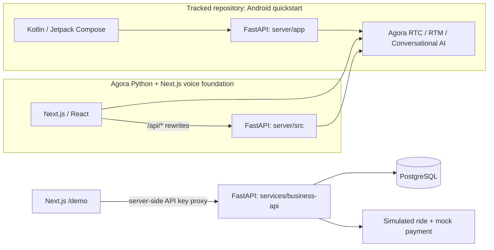
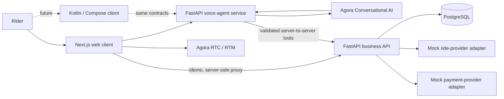

# Bolo Ride Architecture

**Status:** The Agora voice foundation, isolated booking/payment API, and local
web booking demo are present. The live Agora agent, web demo, and Android
client are not yet integrated into one end-to-end voice booking flow.

## Current Architecture

The workspace has two separate voice applications: the root Android quickstart
and an Agora Python + Next.js voice-agent foundation under `bolo-ride-voice/`.



### Existing implementations

| Area | Observed implementation | Current limitation |
| --- | --- | --- |
| Root Android client | Compose screen, microphone/audio controls, RTC/RTM session management, transcripts, interruption, and token renewal under `app/`. | A conversation demo, not a ride-booking UI. |
| Root FastAPI service | `server/app/` issues tokens and manages Agora sessions; `server/app/session_store.py` keeps session state in memory. | No business API or persistent ride state. |
| Nested web client | `bolo-ride-voice/web/` is a Next.js 16/React 19 voice client; it uses Agora RTC/RTM and rewrites `/api/*` to FastAPI. | A separate voice app, not integrated with the Android client. |
| Nested FastAPI service | `bolo-ride-voice/server/src/` owns Agora token generation and agent start/stop; signed session tickets bind renewal and lifecycle requests to a generated session. | Session bookkeeping remains process-local; no ride, fare, or payment domain. |
| Agora pipeline | The Python service uses managed Deepgram `nova-3` (`language="en"`), OpenAI `gpt-4o-mini`, and MiniMax `speech_2_6_turbo` / `English_captivating_female1`. | English-only configuration; Telugu, Hindi, Kannada, and code-mixed speech are not claimed or tested. |
| Business API | `services/business-api/` owns typed fare, booking, simulated driver, and mock-payment routes; SQLAlchemy models and an Alembic initial migration persist records. | The API key is server-only; product-user authentication and production provider integrations are not implemented. |
| Web booking demo | `/demo` calls the business API through an allowlisted Next.js route handler that injects `BUSINESS_API_KEY` server-side. | A manual click-through demo, not connected to the Agora transcript or live voice agent. |
| Persistence | PostgreSQL is the configured runtime database; integration tests and migration checks use SQLite. | Live PostgreSQL startup and production concurrency behavior have not been verified. |

The two services expose different session APIs and should not be treated as
interchangeable. The root service uses versioned `/v1/conversation/*` routes;
the nested quickstart uses `/get_config`, `/startAgent`, and `/stopAgent`.
No route contract currently represents a ride, fare, booking, or payment.

The nested `bolo-ride-voice/server/.env` exists locally and is ignored by that
subtree's `server/.gitignore`. Its contents were not read. Keep it and all
Agora/provider credentials out of commits and browser-facing configuration.
The web client receives an RTC/RTM token and a signed session ticket; neither
contains or replaces the Agora App Certificate.

### Current security and operational boundaries

- Both implementations keep the Agora App Certificate on a Python server.
- The business API requires `X-API-Key`; the web client calls only the
  allowlisted Next.js proxy, so the key is not included in browser bundles.
- Neither implementation has product-user authentication for business actions;
  the local demo credentials and mock routes are not suitable for production.
- The nested service restricts CORS to configured origins and binds token
  renewal, agent start, and agent stop to a signed session ticket. It still has
  no product-user authentication or rate limiting; CORS is not an auth boundary.
- The root service has rate limiting but still has no product identity or
  ride-level authorization.
- Agent/session state is process-local and is lost on restart; it cannot be the
  source of truth for bookings or payment outcomes.

## Proposed Target Architecture

Keep voice transport and business state separate. The model may propose an
action, but only an authenticated business API may authorize and perform it.
The business API and PostgreSQL—not an LLM response, transcript, or tool-call
attempt—must establish booking and payment state.



### Ownership

- **Next.js web client:** voice session UX, transcript, locale selection, fare
  presentation, and an explicit confirmation step. It does not hold Agora
  certificates, provider secrets, or authoritative booking/payment state.
- **Agora voice-agent service:** Agora token/session lifecycle, ASR/LLM/TTS
  configuration, language-aware conversation, and narrowly scoped tool
  adapters. It does not connect directly to PostgreSQL or mutate domain state.
- **FastAPI business API:** authenticated, typed domain operations; server-side
  validation and authorization; fare quotes; booking state transitions; mock
  provider calls; payment verification; idempotency and audit records.
- **PostgreSQL:** durable business records and operation outcomes. Use
  migrations and database constraints as the source of truth; do not rely on
  process-local session dictionaries for business data.
- **Future Android app:** a native Compose client consuming the same approved
  business and voice-session contracts as the web client.

### Safety and consistency requirements

1. Treat speech and model output as proposals. Normalize and validate inputs in
   the business API.
2. Read back the material fare/ride details and require explicit rider
   confirmation before a booking mutation.
3. Give each booking/payment mutation a durable idempotency identity scoped to
   the authenticated rider and operation. Bind it to normalized arguments and
   reject reuse with different arguments. A timeout is an unknown outcome
   until the service reconciles it with its system of record; do not blindly
   retry or claim success.
4. Keep external provider calls outside long-running database transactions.
   Persist intent/state, call the provider, then record and verify its result.
5. Only report payment success after server-side verification. Never collect
   UPI PINs or OTPs through voice.
6. Validate every tool argument and authorization context on the business
   server; prompt rules alone are not an authorization boundary.
7. Keep voice-session lifecycle and barge-in/interruption behavior in the
   voice/client layers; do not couple them to booking persistence.

### Multilingual design

Provide a locale-aware pipeline for Telugu, Hindi, Kannada, and English, but
first verify the current Agora/provider model and voice support for every
language. The inspected quickstarts are English-configured, so language
availability, recognition quality, code-switching, locale-specific prompts,
TTS voice quality, and fallback behavior remain open validation work. Keep
locale-specific speech configuration separate from business rules and API
contracts.

## Proposed Repository Layout

This is a logical target, not a migration performed in this task:

```text
apps/
  web/                         # Next.js rider experience
  android/                     # Future native Compose client
services/
  voice-agent/                 # Agora Python starter-derived service
  business-api/                # FastAPI domain and provider boundary
    app/
      api/
      domain/
      providers/
      persistence/
    migrations/
packages/
  contracts/                   # Shared/generated API contracts
infra/
  postgres/                    # Local database and migration support
docs/
  ARCHITECTURE.md
  ROADMAP.md
```

Before adopting this layout, decide how to preserve the root Android
implementation and the separate web/Python voice foundation. Do not move or
consolidate either tree without reviewing its local environment files and Git
status.

## Missing Components

- Connect the voice agent to the business API through typed server-to-server
  tools; keep mock outcome simulation out of model-callable tools.
- Integrate the business API with the Android client while keeping its API key
  server-side.
- Telugu, Hindi, and Kannada pipeline configuration and end-to-end voice tests.
- A single canonical repository layout and shared verification workflow.
- Product authentication, authorization, privacy, and production deployment controls.

For API routes, payload ownership, and local environment variables, see
[the business API documentation](services/business-api/API.md).
