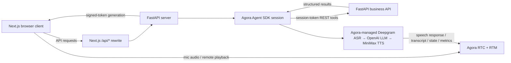

# Bolo Ride Voice-Agent Foundation

This implementation derives from Agora's official Python Conversational AI
quickstart. The nested project contains a Next.js web client and a FastAPI
agent service; it is separate from the root Kotlin/Compose demo.

## Architecture

- `web/` owns browser microphone capture and publishing, RTC joining and remote
  playback, RTM login/subscription, transcript display, runtime event display,
  token renewal, and user-triggered teardown.
- `server/src/server.py` owns CORS, token issuance, session-ticket checks, the
  HTTP contract, and the session-protected REST tool callback. `server/src/agent.py`
  owns the Agora SDK client, managed model chain, VAD settings, and agent
  start/stop lifecycle.
- `server/src/booking_tools.py` owns typed tool schemas, per-voice-session
  conversation state, server-only business API authentication, idempotency
  keys, and structured upstream error handling. It never connects to the
  database directly.
- `web/next.config.ts` rewrites browser `/api/*` requests to FastAPI. The
  browser never imports Agora server credentials or provider API keys.
- `services/business-api/` remains the source of truth for fare validation,
  bookings, and payment verification; the voice service reaches it only over
  authenticated server-to-server HTTP.

## Audio Flow

1. The browser requests initial configuration from `/api/get_config`.
2. FastAPI generates a random channel, a numeric rider UID and agent UID, an
   RTC/RTM token, and a signed session ticket.
3. FastAPI starts the agent with the ticket-bound channel and UIDs while the
   browser logs into RTM and subscribes to the same channel.
4. `useJoin` joins the browser to RTC; `useLocalMicrophoneTrack` creates the
   microphone track and `usePublish` sends it to the channel.
5. Agora Conversational AI receives the rider audio, executes ASR → LLM → TTS,
   and publishes generated audio back to RTC. `RemoteUser` renders the agent
   audio track in the browser.
6. The browser's `AgoraVoiceAI` toolkit receives transcript and runtime
   messages over RTM. Transcript turns, state, metrics, and errors are held in
   component memory and displayed in the UI.
7. End-call stops the agent, unpublishes/stops/closes the microphone, leaves
   RTC through `agora-rtc-react` hook ownership, and logs out of RTM.

## ASR → LLM → TTS

The current configured chain in `server/src/agent.py` is:

| Stage | Actual configuration | Credential mode |
| --- | --- | --- |
| ASR | Deepgram Nova-3, `language="multi"`, hints `en`, `hi`, `kn`, `te` | Agora-managed; multilingual code-switching configuration |
| LLM | OpenAI `gpt-4o-mini`, 15-message history, max 1024 tokens | Agora-managed; no OpenAI key supplied |
| TTS | Murf Falcon 2.1, voice `Pooja`, locale selected per session when `MURF_API_KEY` is configured | Server-side Murf key |
| TTS fallback | MiniMax `speech_2_6_turbo` for English and Hindi | Agora-managed; Telugu/Kannada require Murf |

The web pre-call screen selects English, Hindi, Kannada, or Telugu; the selection
is fixed for that session's response language and TTS locale. Deepgram Nova-3's
multilingual mode is documented for all four languages and mid-sentence
switching. This repository's tests validate configuration, not live audio
quality or end-to-end code-switching.

When `BUSINESS_API_URL`, `BUSINESS_API_KEY`, and `AGENT_PUBLIC_URL` are all
configured, the Bolo Ride system prompt enables narrow booking tools and
`advanced_features.enable_tools` is true. Otherwise, the agent uses a
voice-only prompt that prohibits booking, fare, and payment claims.

## Booking Tool Flow

1. Agent startup creates an unpredictable per-session bearer token and injects
   it into Agora's REST tool template variables. The business API key remains
   only in the voice service environment.
2. Agora POSTs the selected tool's structured JSON to
   `AGENT_PUBLIC_URL/v1/agent-tools/{tool_name}`. That URL must be reachable
   from Agora; for local development it requires a public HTTPS tunnel to the
   voice service.
3. FastAPI checks the session token, validates the Pydantic input, serializes
   operations for that voice session, and calls the business API using
   `X-API-Key`.
4. The business API revalidates details and fare, stores bookings/payments, and
   enforces durable idempotency. Booking creation requires an explicit
   passenger confirmation after reading back the current fare. Only
   `verify_payment` returning `VERIFIED` can be described as successful.
5. Session stop revokes the tool token. Mock payment simulation is not exposed
   to the LLM.

Conversation state is process-local and separate from database state. A voice
service restart loses current conversational context, but does not erase
business records. The current prototype has no rider authentication, so do not
expose it publicly as a production service.

## RTC/RTM Session Lifecycle

1. **Initialize:** `GET /get_config` with no query parameters creates a
   cryptographically random channel and UIDs. It returns `app_id`, a
   one-hour RTC/RTM token, identities, and a signed session ticket.
2. **Start:** `POST /startAgent` requires the initial ticket and matching
   channel/UIDs. FastAPI starts an Agora async session and returns the
   `agent_id` plus a ticket bound to that agent. Repeated start requests with
   the same bootstrap ticket reuse the process-local result.
3. **Connect:** the browser starts RTM login and agent startup concurrently,
   waits up to ten seconds for RTM `CONNECTED`, subscribes to the channel,
   joins RTC with the explicit server-issued UID, publishes microphone audio,
   and initializes `AgoraVoiceAI`.
4. **Renew:** on RTC `token-privilege-will-expire`, the client requests a new
   token using its channel, UID, and agent-bound ticket. The signed ticket must
   match these values and be unexpired. The same UID's token renews both RTC
   and RTM.
5. **Interrupt:** the agent uses VAD start/end detection. A user speaking
   during agent speech can interrupt after `interrupt_duration_ms=160`;
   `prefix_padding_ms=300` retains the start of speech. Interrupted turns are
   marked from transcript `TurnStatus.INTERRUPTED`.
6. **Reconnect:** RTC connection state is surfaced as connecting, reconnecting,
   connected, or disconnected. Agora RTC/RTM SDKs own their network recovery;
   this app renews expiring tokens but does not restart the agent after a
   disconnect. RTM re-subscription after later network reconnection requires
   live verification.
7. **Stop:** `POST /stopAgent` requires a ticket containing the same agent ID,
   channel, and UID. The browser then releases local media and logs out of RTM.

### Token Generation and Trust Boundary

- `AGORA_APP_ID` and `AGORA_APP_CERTIFICATE` are read only by FastAPI from
  process environment or `server/.env`. Host environment values take
  precedence over `.env`.
- `generate_convo_ai_token` generates the RTC/RTM token with a 3600-second
  lifetime. The App Certificate is never returned, logged, or bundled in the
  web/Android client.
- FastAPI signs session tickets with HMAC-SHA256 using a domain-separated key
  derived from the server-only App Certificate. Tickets bind a generated
  channel, rider UID, agent UID, random ticket ID, and expiry; after start they
  also bind the Agora agent ID.
- A ticket is a capability to operate on that one session. It is returned to
  the browser and must be treated as sensitive; it is not an Agora token or
  replacement for user authentication.
- `AGENT_ALLOWED_ORIGINS` configures CORS. CORS does not protect the API from
  direct clients. Product authentication and rate limiting remain necessary
  before a public production deployment.

## Runtime Events and Transcript

The agent enables RTM, metrics, and error messages. The browser toolkit
currently handles:

| Event | Use |
| --- | --- |
| `TRANSCRIPT_UPDATED` | Keep partial/final turns in React state; interrupted turns are labeled in the transcript. |
| `AGENT_STATE_CHANGED` | Drive listening/thinking/speaking visualizer state. |
| `AGENT_METRICS` | Display the latest ASR, LLM, and TTS measurements. |
| `AGENT_ERROR` | Add agent/module failures to the connection detail panel. |
| `MESSAGE_ERROR` | Surface RTM message delivery errors. |
| `MESSAGE_SAL_STATUS` | Surface signaling registration failures. |
| Raw RTM `message` | Fallback parsing for message errors and SAL status. |
| RTC `connection-state-change` | Display RTC connection and reconnecting state. |

The transcript and events are ephemeral browser state. The project does not
configure Agora webhooks, server-side history retrieval, durable transcript
storage, alerting, or cross-session analytics.

## Latency Measurement

`parameters.enable_metrics=true` enables agent metrics. The UI stores a bounded
window of the latest eight measurements and displays the latest ASR/LLM/TTS
metric names and values in milliseconds. Use the event's `type`, `name`,
`value`, and `timestamp` to identify a measurement; Agora commonly reports ASR
time-to-last-word (`asr_ttlw`), LLM time-to-first-byte/first-sentence
(`llm_ttfb` / `llm_ttfs`), and TTS time-to-first-byte (`tts_ttfb`).

The quickstart does not compute or persist a full end-to-end latency number.
No live voice call or latency sample has been verified for this Bolo Ride
workspace. The Agora pipeline's live metrics—not documentation estimates—must
be measured before setting a performance target.

## Known Limitations

- Provider documentation covers the selected language models, but live
  recognition, spoken output, code-switching quality, and latency are not
  verified; Kannada/Telugu TTS also requires `MURF_API_KEY`.
- No user authentication, request rate limiting, or durable session store.
- Session deduplication and active `AgentSession` objects are process-local;
  multi-worker deployment and restart recovery are not implemented.
- No durable transcripts or backend runtime-event ingestion/webhooks.
- RTM resubscription and agent recovery after a later network interruption
  have not been verified in a live call.
- Tool calls require a public route reachable by Agora and server-side
  `AGENT_PUBLIC_URL`, `BUSINESS_API_URL`, and `BUSINESS_API_KEY` configuration.
- No rider authentication, rate limiting, or durable voice-conversation state.
- The root Android quickstart is not yet a client of this Python service.
- Automated tests use fake agents/tokens and do not establish live Agora
  credentials, network connectivity, microphone capture, or audio playback.

## References

- [Agora Conversational AI quickstart](https://docs.agora.io/en/ai/get-started/quickstart)
- [Start and stop an agent](https://docs.agora.io/en/ai/build/start-stop-agent)
- [Monitor agent runtime](https://docs.agora.io/en/ai/build/handle-runtime-events/monitor-agent-runtime)
- [Get runtime events](https://docs.agora.io/en/ai/build/handle-runtime-events/get-runtime-events)
- [Optimize latency](https://docs.agora.io/en/ai/best-practices/optimize-latency)
