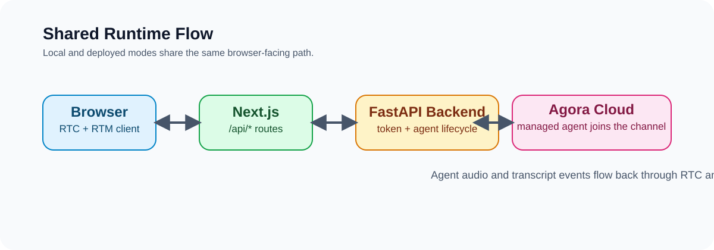

# Agora Conversational AI Python Quickstart

[](./LICENSE)
[](https://www.python.org/)
[](https://bun.sh/)

Build a production-style voice agent with a Next.js web client and Python FastAPI backend. This quickstart includes live transcript, agent visualizer ([Agent UIKit](https://agoraio-conversational-ai.github.io/agent-uikit/)), and managed STT/LLM/TTS defaults.

## Bolo Ride Foundation

This Agora Python quickstart is the current web voice-agent foundation for Bolo
Ride. It provides an English conversation path and, when configured, a
server-side tool connection to the separate Bolo Ride business API. Booking
and payment state remain controlled by that API; the agent runs voice-only if
the business API configuration is missing.

## Prerequisites

- [Python 3.10+](https://www.python.org/)
- [Bun](https://bun.sh/)
- [Agora CLI](https://github.com/AgoraIO/cli)

## Run It

Install the CLI (skip if already installed), scaffold the Python quickstart, install dependencies, and run.

1. **Install the Agora CLI and sign in** (skip if `agora` is already on your PATH):

   ```bash
   curl -fsSL https://raw.githubusercontent.com/AgoraIO/cli/main/install.sh | sh -s -- --add-to-path
   agora login
   ```

2. **Scaffold and run** (replace `my-python-demo` with your own project name):

   ```bash
   agora init my-python-demo --template python
   cd my-python-demo
   bun run setup
   bun run dev
   ```

3. Open [http://localhost:3000](http://localhost:3000) and click **Start conversation**.

If the agent does not join or transcripts do not appear, run **`agora project doctor --deep`** to check credentials, feature enablement, network reachability, and local env binding.

### Working from a clone of this repository

Use this path if you already cloned **this** repo:

```bash
git clone https://github.com/AgoraIO-Conversational-AI/agent-quickstart-python.git
cd agent-quickstart-python
agora login
agora project use <your-project>
bun run setup
agora quickstart env write .
bun run doctor:local
bun run dev
```

`bun run setup` preserves a configured `server/.env`, copies a legacy `server/.env.local` when needed, and prints the credential-writing step when the resulting file lacks real Agora values. Setup and `doctor:local` replace an untouched example file with configured legacy credentials. This supports CLI versions that wrote `.env.local`.

Services:

- Frontend: `http://localhost:3000`
- Backend: `http://localhost:8000`
- API docs: `http://localhost:8000/docs`

## Deploy

Deploy `web` as a Next.js app and `server` as a reachable Python service.

Browser-facing `/api/*` routes in Next proxy to FastAPI via:

```bash
AGENT_BACKEND_URL=https://your-python-backend.example.com
```

Set backend env values:

```bash
AGORA_APP_ID=your_agora_app_id
AGORA_APP_CERTIFICATE=your_agora_app_certificate
```

To export local env values from the Agora CLI-bound project:

```bash
agora project use <your-project>
agora quickstart env write .
rg "^(AGORA_APP_ID|AGORA_APP_CERTIFICATE)=" server/.env
```

## Environment variables

Primary backend env file: [`server/.env.example`](server/.env.example).

| Variable | Required | Default | Notes |
| --- | :---: | :---: | --- |
| `AGORA_APP_ID` | ✅ | — | Agora Console -> Project -> App ID |
| `AGORA_APP_CERTIFICATE` | ✅ | — | Agora Console -> Project -> App Certificate (server only) |
| `PORT` |  | `8000` | FastAPI server port |
| `AGENT_ALLOWED_ORIGINS` |  | `http://localhost:3000,http://127.0.0.1:3000` | Comma-separated FastAPI CORS origins |
| `AGENT_BACKEND_URL` (web deploy) | ✅ | — | Required in deployed `web` app when proxying to external FastAPI |
| `AGENT_PUBLIC_URL` | ✅ for tools | — | Public HTTP(S) base URL reachable by Agora for REST tool callbacks |
| `BUSINESS_API_URL` | ✅ for tools | — | Business API URL reachable by the voice service; local default is `http://127.0.0.1:8010` |
| `BUSINESS_API_KEY` | ✅ for tools | — | Server-to-server key; never put this in web or Android configuration |

The configured pipeline is Agora-managed Deepgram `nova-3` ASR
(`language="en"`), OpenAI `gpt-4o-mini` LLM, and MiniMax
`speech_2_6_turbo` TTS with `English_captivating_female1`. No provider API keys
are required for this managed chain. The ASR language and TTS voice are English;
support for Telugu, Hindi, Kannada, or code-mixed speech has not been verified.

## Commands

```bash
# Dev
bun run setup
bun run dev

# Quality
bun run doctor
bun run doctor:local
bun run verify:backend

# CI / pre-ship
bun run verify:web
bun run verify:local
bun run verify
```

Run `bun run verify` before shipping web-only changes, and `bun run verify:local` when backend behavior changed.

Tests run standalone (no Agora cloud needed): `pytest` in `server/`, `bun test` in `web/`. CI runs them on Linux/macOS/Windows × Python 3.10 & 3.13.

## Architecture

<picture>
  <source media="(prefers-color-scheme: dark)" srcset="./.github/images/system-architecture-dark.svg">
  
</picture>

The browser talks to Next.js `/api/*` routes. In local mode, Next rewrites those routes to FastAPI using `AGENT_BACKEND_URL=http://localhost:8000`; FastAPI owns token generation and agent start/stop logic.

## What You Get

- Next.js web client (`web/`) with transcript UI and agent visualizer
- FastAPI backend (`server/`) for token generation and agent lifecycle
- `/api/get_config`, `/api/startAgent`, and `/api/stopAgent` browser-facing contract
- Managed default pipeline (Deepgram STT, OpenAI LLM, MiniMax TTS)
- Optional typed ride-booking/payment tools routed to the separate business API

## How It Works

1. Browser requests initial config from `/api/get_config`.
2. FastAPI generates a random channel and numeric UIDs, mints an RTC/RTM token,
   and returns a signed, expiring session ticket.
3. Browser starts the agent with that ticket, logs into RTM, subscribes to the
   channel, joins RTC, and publishes microphone audio.
4. Agora carries audio to the managed ASR → LLM → TTS pipeline and returns
   agent audio over RTC; the browser plays the remote track.
5. Transcript, state, errors, and metrics arrive over RTM. Before token
   expiry, the browser renews only the UID/channel bound to its session ticket.
6. On end, the browser stops the ticket-bound agent, releases microphone/RTC
   resources, and logs out of RTM.
7. When configured, Agora posts tool calls to the session-token protected voice
   service, which validates inputs and calls the business API using its
   server-only `X-API-Key`.

## Voice Architecture and Runtime

- **Audio flow:** browser microphone track → RTC channel → Agora agent →
  managed ASR → LLM → TTS → RTC remote audio playback.
- **Interruption:** the agent VAD uses `interrupt_duration_ms=160` and
  `prefix_padding_ms=300`; interrupted transcript turns are marked in the UI.
- **Reconnects:** the RTC client exposes `CONNECTING`, `RECONNECTING`, and
  disconnect states; the UI reflects them. Token renewal refreshes both RTC
  and RTM with the same concrete session UID. RTM re-subscription after a
  later network reconnect has not been verified in a live call.
- **Runtime events:** the browser listens for transcript updates, agent state,
  ASR/LLM/TTS metrics, agent/module errors, and RTM signaling errors. These
  events and the transcript are held in client memory; no webhook or durable
  transcript storage is configured.
- **Latency:** `AGENT_METRICS` provides per-module metric type, name, value,
  and timestamp. The UI displays the latest ASR/LLM/TTS values in milliseconds.
  No live latency measurement has been collected as part of this implementation.
- **Token boundary:** the App Certificate stays in the FastAPI environment.
  The signed session ticket is an expiring capability derived from the
  server-side certificate; it is not an Agora certificate or provider key.
  CORS is origin-restricted, but the service has no product-user authentication
  or rate limiting and is not production-ready.
- **Business tools:** `AGENT_PUBLIC_URL`, `BUSINESS_API_URL`, and
  `BUSINESS_API_KEY` are server-side settings. Agora must reach the public
  callback URL; use a public HTTPS tunnel for local voice tests. The LLM can
  request fare, booking, and payment operations but cannot simulate a payment
  result; the backend must return `VERIFIED` before success is reported.

For the full sequence, token claims, event mapping, latency notes, and known
limitations, see [ARCHITECTURE.md](./ARCHITECTURE.md).

## Repo Map

- `web/` — Next.js 16 + React 19 + TypeScript frontend
- `server/` — Python FastAPI backend + Agora Agent Server SDK integration
- `ARCHITECTURE.md` — system-level flow and ownership boundaries
- `AGENTS.md` — contributor agent instructions

## Troubleshooting

- **Agent does not join or transcripts are missing:** run `agora project doctor --deep`.
- **Missing credentials:** run `agora quickstart env write .`.
- **Auth errors from backend:** confirm `AGORA_APP_ID` and `AGORA_APP_CERTIFICATE` are set in `server/.env`.
- **Frontend cannot reach backend:** confirm `AGENT_BACKEND_URL=http://localhost:8000` in local frontend scripts.
- **Unsure who owns `/api/*`:** Next owns browser-facing `/api/*`; FastAPI owns `/get_config`, `/startAgent`, `/stopAgent`.

## More Docs

- [ARCHITECTURE.md](./ARCHITECTURE.md)
- [AGENTS.md](./AGENTS.md)
- [docs/ai/L1/02_architecture.md](./docs/ai/L1/02_architecture.md) — full-stack topology and lifecycle
- [docs/ai/L1/03_code_map.md](./docs/ai/L1/03_code_map.md) — curated `web/` + `server/` file map

## License

Released under the [MIT License](./LICENSE).
